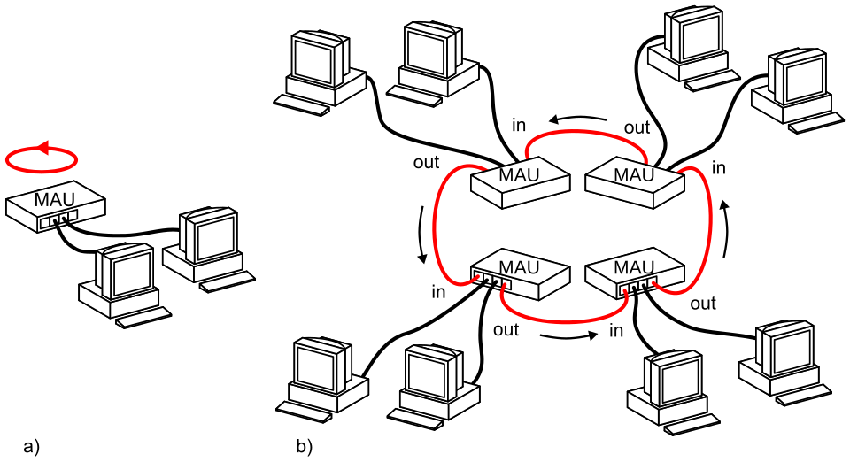

# Appunti terzo classwork

## Token Ring IEEE 802.5

È stato introdotto da IBM nel 1984 e standardizzato come IEEE 802.5. Utilizza un frame di 3 bytes chiamato *token* ch viene passato attraverso un anello logico composto da workstations e server. Il passaggio di token è un metodo di accesso che fornisce un accesso equo per tutte le stazioni ed elimina le collisioni.
La tecnologia token ring è diventata ampiamente utilizzata, in particolare in ambiente aziendale, ma gradualmente rimpiazzata da nuove interazioni di Ethernet.

### Confronto con Ethernet

Sono entrame tecnologie utilizzate per collegare più computer all'interno di una rete LAN. La differenza principale riguarda il modo in cui i computer comunicano e si dividono il canale di trasmissione.
Nel modello token ring a differenza dell'ethernet il computer deve attendere la ricezione di un token prima di trasmettere. Questa pratica permette di ridurre le collisioni a zero.
Nonostante ciò Ethernet ha avuto piu successo principalemente per 3 motivi:

1. costo inferiore
2. maggiore semplicità
3. grzie ai cavi a doppino intrecciato e degli switch, Ethernet è diventata più conveniente e veloce.

### Processo

Il processo di trasmissione dei dati opera come segue:

1. il token passa continuamente da una macchina all'altra nell'anello. Finché libero permette ad un computer di trasmettere.
2. quando un computer vuole inviare un messaggio intercetta il token libero, lo contrassegna come occupato e inserisce al suo interno i dati da trasmettere e l'indirizzo del destinatario.
3. il frame passa da una macchina all'altra. Ogni computer controlla l'indirizzo del destinatario. Se non è il destinatario inoltra il pacchetto al computer successivo.
4. quando il pacchetto raggiunge il pacchetto destinatario, quest'ultimo copia i dati e modifica alcuni bit del frame per segnalare che il messaggio è stato ricevuto e copiato. <!-- aggiornare la parte di pacchetto modificata -->
5. il pacchetto continua a circolare fino a raggiungere nuovamente il computer che lo aveva inviato. Il mittente controlla i bit di stato per verificare se il destinatario ha ricevuto e copiato correttamente il messaggio.
6. il mittente rimuove i dati e lo rende nuovamente disponibile.

### Cablaggio

### Frames

#### Token

Il token IEEE 802.5 è composto da 3 byte (24 bit).

\begin{center}
\begin{tikzpicture}

% Dimensioni
\def\w{3.6}
\def\h{1.5}
\def\gap{0.07}

% Primo byte - SD
\fill[blue!80!cyan, rounded corners=3pt]
    (0,0) rectangle (\w,\h);

\node[white, font=\sffamily\bfseries\Large]
    at (\w/2,1.08) {8 bit};

\node[white, font=\sffamily\small]
    at (\w/2,0.35) {SD};

% Secondo byte - AC
\fill[teal!80!green, rounded corners=3pt]
    (\w+\gap,0) rectangle (2*\w+\gap,\h);

\node[white, font=\sffamily\bfseries\Large]
    at (1.5*\w+\gap,1.08) {8 bit};

\node[white, font=\sffamily\small]
    at (1.5*\w+\gap,0.35) {AC};

% Terzo byte - ED
\fill[violet!85, rounded corners=3pt]
    (2*\w+2*\gap,0) rectangle (3*\w+2*\gap,\h);

\node[white, font=\sffamily\bfseries\Large]
    at (2.5*\w+2*\gap,1.08) {8 bit};

\node[white, font=\sffamily\small]
    at (2.5*\w+2*\gap,0.35) {ED};

\end{tikzpicture}
\end{center}

- SD: indica l'inizio del token
- AC: contiene le informazioni di controllo priorità
- ED: indica la fine del token

##### Access Control (AC)

\begin{center}
\begin{tikzpicture}
\matrix[
    matrix of nodes,
    nodes={
        minimum width=1.2cm,
        minimum height=0.5cm,
        inner sep=0pt,
        text=white,
        font=\sffamily\bfseries\small,
        rounded corners=2pt,
        anchor=center
    },
    column sep=1pt
] {
    |[fill=blue!75!black]| P0 &
    |[fill=blue!75!black]| P1 &
    |[fill=blue!75!black]| P2 &
    |[fill=teal!75!black]| T &
    |[fill=orange!85!black]| M &
    |[fill=gray!65!blue]| R0 &
    |[fill=gray!65!blue]| R1 &
    |[fill=gray!65!blue]| R2 \\
};
\end{tikzpicture}
\end{center}

- `P0`, `P1`, `P2` indicano la priorità del token o del pacchetto
- `T` distingue un token da un pacchetto (T=0 token libero, T=1 pacchetto)
- `M` monitor bit usato per il controllo dell'anello
- `R0`, `R1`, `R2` bit di prenotazione della priorità

#### Frame

Quando una stazione acquisisce il token può trasmettere un frame contenente informazioni. Il frame dati è più grande del token e presenta una struttura composta da diversi campi.

\begin{center}
\begin{tikzpicture}
\matrix[
    matrix of nodes,
    nodes={
        minimum height=0.5cm,
        inner sep=3pt,
        outer sep=0pt,
        text=white,
        font=\sffamily\bfseries\small,
        rounded corners=2pt,
        anchor=center,
        align=center
    },
    column sep=1pt,
    row sep=3pt
] {
    |[fill=blue!75!black, minimum width=1.15cm]| SD &
    |[fill=teal!75!black, minimum width=1.15cm]| AC &
    |[fill=red!65!black, minimum width=1.15cm]| FC &
    |[fill=blue!75!black, minimum width=1.15cm]| DA &
    |[fill=blue!75!black, minimum width=1.15cm]| SA &
    |[fill=gray!65!blue, minimum width=1.15cm]| RI &
    |[fill=teal!75!black, minimum width=1.15cm]| INFO &
    |[fill=orange!85!black, minimum width=1.15cm]| FCS &
    |[fill=blue!75!black, minimum width=1.15cm]| ED &
    |[fill=orange!85!black, minimum width=1.15cm]| FS \\

    |[text=black, font=\sffamily\scriptsize]|  &
    |[text=black, font=\sffamily\scriptsize]| 1 byte &
    |[text=black, font=\sffamily\scriptsize]| 1 byte &
    |[text=black, font=\sffamily\scriptsize]| 6 byte &
    |[text=black, font=\sffamily\scriptsize]| 6 byte &
    |[text=black, font=\sffamily\scriptsize]| 0--30 byte &
    |[text=black, font=\sffamily\scriptsize]| Variabile &
    |[text=black, font=\sffamily\scriptsize]| 4 byte &
    |[text=black, font=\sffamily\scriptsize]| 1 byte &
    |[text=black, font=\sffamily\scriptsize]| 1 byte \\
};
\end{tikzpicture}
\end{center}

- FC: è un byte che identifica la tipologia del frame
- DA: indirizzo MAC del destinatario
- SA: indirizzo MAC del mittente
- RI: è un campo opzionale che può ranggiungere i 30 byte e viene utilizzato quando il mittente specifica il percorso che il frame deve seguire attraverso i bridge della rete
- INFO: contiene i dati veri e propri
- FCS: contiene un valore di controllo calcolato mediante un algoritmo CRC.

---

## Real Time Protocol (RTP)

RTP  è un protocollo e rappresenta un valido supporto per il trasferimento di dati in tempo reale, come ad esempio flussi audio e video. I servizi forniti da RTP sono essenzialmente i seguenti:

1. identificazione del payload type
2. sequence numbering
3. timestamping
4. monitoring

Le applicazioni tipicamente pongono RTP sopra UDP. Il trasferimento di dati verso molteplici destinazioni avviene con una distribuzione multicast.
E' da notare che questo protocollo non prevede **nessun meccanismo che assicuri una corretta trasmissione** o che garantisca la qualità del servizio, in quanto questo e' compito degli strati più bassi. Inoltre **non si interessa direttamente di un errato ordine di consegna** dei pacchetti. I numeri di sequenza inclusi da RTP permettodono al ricevente di ricostruire la sequenza.

Lo standard è diviso in due parti strettamente legate:

1. Realtime Transport Protocol (RTP): per trasportare i dati con proprietà temporali;
2. RTP Control Protocol (RTCP): per monitorare la qualità del servizio e fornire informazioni sui partecipanti di una sessione.

\begin{figure}[ht]
    \centering
    \begin{tikzpicture}[font=\normalsize]

        % Dimensioni del protocol stack
        \def\W{8}
        \def\H{4}
        \def\h{1.4}

        % Contorno esterno
        \draw[line width=0.9pt] (0,0) rectangle (\W,\H);

        % Divisioni orizzontali
        \draw[line width=0.7pt] (0,2.6) -- (\W,2.6);
        \draw[line width=0.7pt] (0,1.3) -- (\W,1.3);

        % Divisione verticale tra RTP e RTCP
        \draw[line width=0.7pt] (4,2.6) -- (4,4);

        % Etichette
        \node at (2,3.3) {RTP};
        \node at (6,3.3) {RTCP};
        \node at (4,1.95) {UDP};
        \node at (4,0.65) {IP};

    \end{tikzpicture}
\end{figure}

### Esempi d'impiego

In una conferenza audio/video entrami i media sono trasmessi come sessioni RTP separate e i pacchetti RTCP relativi usano due differenti coppie di porte UDP. Le sessioni RTP audio e video non sono perciò accoppiate tra loro per permettere ai partecipanti di ricevere soltanto uno dei due media a loro scelta. Nonostante questo è possibile sincronizzare il playback usando le informazioni di temporizzazione trasportate nei pacchetti RTCP.

\begin{figure}[htbp]
\centering
\begin{tikzpicture}[
    app/.style={
        circle,
        draw=blue!55!black,
        fill=blue!5,
        line width=1.2pt,
        minimum size=2.5cm,
        align=center,
        font=\small
    },
    multicast/.style={
        rectangle,
        rounded corners=7pt,
        draw=black!75,
        fill=gray!10,
        line width=1.4pt,
        minimum width=3.6cm,
        minimum height=1.7cm,
        align=center,
        font=\small
    },
    audio/.style={
        <->,
        >=Stealth,
        draw=blue!75!black,
        line width=1.1pt
    },
    video/.style={
        <->,
        >=Stealth,
        draw=red!75!black,
        line width=1.1pt
    },
    lab/.style={
        font=\scriptsize,
        fill=white,
        inner sep=2pt
    }
]

% ==========================================
% APPLICAZIONI
% ==========================================

\node[app] (A) at (-5.5,0) {
    \textbf{Applicazione}\\
    \textbf{A}
};

\node[app] (C) at (5.5,0) {
    \textbf{Applicazione}\\
    \textbf{C}
};

\node[app] (B) at (0,-5.5) {
    \textbf{Applicazione}\\
    \textbf{B}
};

% ==========================================
% GRUPPO MULTICAST
% ==========================================

\node[multicast] (M) at (0,0) {
    \textbf{\large MULTICAST}\\[5pt]
    \texttt{224.0.1.140}
};

% ==========================================
% APPLICAZIONE A - MULTICAST
% ==========================================

\draw[audio] (-4.25,0.45) -- (-1.85,0.45);
\draw[audio] (-4.25,0.15) -- (-1.85,0.15);

\draw[video] (-4.25,-0.15) -- (-1.85,-0.15);
\draw[video] (-4.25,-0.45) -- (-1.85,-0.45);

% ==========================================
% APPLICAZIONE C - MULTICAST
% ==========================================

\draw[audio] (1.85,0.45) -- (4.25,0.45);
\draw[audio] (1.85,0.15) -- (4.25,0.15);

\draw[video] (1.85,-0.15) -- (4.25,-0.15);
\draw[video] (1.85,-0.45) -- (4.25,-0.45);

% ==========================================
% APPLICAZIONE B - MULTICAST
% ==========================================

\draw[audio] (-0.55,-1.0) -- (-0.55,-4.25);
\draw[audio] (-0.20,-1.0) -- (-0.20,-4.25);

\draw[video] (0.20,-1.0) -- (0.20,-4.25);
\draw[video] (0.55,-1.0) -- (0.55,-4.25);

% ==========================================
% LEGENDA
% ==========================================

\node[font=\scriptsize] at (0,-7.0) {
    \textcolor{blue!75!black}{\rule{0.5cm}{1.2pt}}
    \quad RTP/RTCP Audio
    \qquad
    \textcolor{red!75!black}{\rule{0.5cm}{1.2pt}}
    \quad RTP/RTCP Video
};

\end{tikzpicture}
\end{figure}

Ogni partecipante invia i dati audio in pacchetti da $20ms$ di durata con un header RTP in cui è indicata la codifica usata per l'audio. Il payload type può cambiare durante la conferenza per reagire ad esempio ad un calo di banda.

### Protocollo di trasporto (RTP)

Per ogni partecipante di una conferenza, la sessione RTP è definita da una particolare coppia di indirizzi di destinazione:

1. indirizzo di rete
2. una coppia di porte (RTP e RTCP)

In una conferenza multimediale ogni media (audio o video) ha una sua separata sessione con i propri pacchetti RTCP.

Il pacchetto dati consiste in un header fisso RTP, una eventuale lista chiamata contributing source (CSRC) e il payload data (la sorgente dati).

### Protocollo di controllo (RTCP)

L'RTP Control Protocol è basato sulla trasmissione periodica dei pacchetti di controllo a tutti i partecipanti ad una sessione. Il protocollo sottostante deve quindi provvedere alla separazione dei pacchetti usando porte con numeri diversi.

L'RTCP ha 4 funzioni:

1. controllo qualità della trasmissione dati
2. assegna CNAME (codice univo assegnato ad ogni mittente in modo da riconoscerlo anche nel caso di un cambio di codice sessione)
3. regolazione del traffico
4. gestione conferenze aperte (opzionale)

RTCP si basa sulla trasmissione di 5 tipi di pacchetto:

- SR (sender report): per portare statistiche di ricezione e trasmissione
- RR (receiver report): statistiche di ricezione
- SDES (source descriptor): per gli elementi di descrizione, incluso CNAME
- BYE: fine di una partecipazione
- APP: pacchetti per funzioni specifiche di un'applicazione

Ogni pacchetto è costituito da una prima parte fissa e da una seconda variabile. Più pacchetti RTCP possono essere inviati in uno stesso pacchetto UDP, ogni pacchetto deve però essere processato indipendentemente.

## Banda impiegata

RTP è un protocollo progettato per sessioni che vanno da pochi a migliaia di partecipanti, quindi non solo per servizi di videoconferenza ma anche per servizi di video on demand, o trasmissioni “TV” su Internet. Non stupisce quindi l’attenzione che viene data al controllo della banda impiegata.

Prima di tutto va notato che la banda impiegata dalle trasmissioni audio sono auto limitate perché in generale parla un solo interlocutore alla volta. Per quanto riguarda il traffico video, esso cresce con il numero dei partecipanti, ma si suppone che in una conferenza il numero dei partecipanti sia limitato mentre in una trasmissione TV, la sorgente video è una sola. Si conclude quindi che anche il traffico video è auto limitato.

\begin{figure}[htbp]
\centering
\begin{tikzpicture}[
    x=1cm,
    y=1cm,
    line width=0.8pt,
    >=stealth,
    font=\small
]

% Dimensioni barra
\def\L{12}
\def\H{1.55}
\def\C{0.75}

% Barra principale
\draw (0,0) rectangle (\L,\H);
\draw (\C,0) -- (\C,\H);

% Testi nella barra
\node[rotate=90,font=\bfseries\small] (node1)
    at (0.37,0.775) {T. RTCP};

\node[font=\bfseries] at (6.4,0.775)
    {Traffico RTP};

% Casella intervallo di trasmissione
\draw (-0.1,3.85) rectangle (4.85,4.65);
\node[font=\bfseries] at (2.375,4.25)
    {Intervallo di trasmissione.};

% Freccia verso RTCP
\draw (0.37,3.85) -- (0.37,1.55);

% Casella tipo codifica
\draw (3.5,2.45) rectangle (8.9,3.25);
\node[font=\bfseries] at (6.2,2.85)
    {Tipo codifica audio/video.};

% Freccia verso RTP
\draw (6.2,2.45) -- (6.2,1.55);

% Percentuali
\node[anchor=west] at (-0.22,-0.38) {0\%};
\node[anchor=west] at (0.46,-0.38) {5\%};
\node[anchor=west] at (11.51,-0.37) {100\%};

% Freccia larghezza di banda
\draw[<->] (0,-1.15) -- (\L,-1.15);

% Etichetta larghezza di banda
\node[fill=white,inner sep=4pt] at (6,-1.15)
    {Larghezza di banda usata.};

\end{tikzpicture}
\end{figure}

Per ogni sessione si suppone quindi che il traffico sia sottoposto ad un limite di banda, da dividere fra i partecipanti. Tale limite di banda può essere scelto secondo qualche criterio (ad esempio il costo della banda, o una percentuale della banda disponibile).

---

## References
<!-- Token Ring -->
- https://en.wikipedia.org/wiki/Token_Ring
- https://www3.diism.unisi.it/~giambene/reti_di_telecomunicazioni_materiale/materiale_didattico/Nuovo_Ordinamento/Accesso_multiplo_MAC.PDF
<!-- Real Time Protocol (RTP) -->
- https://homes.di.unimi.it/~alberti/Mm07/doc/rtp.pdf